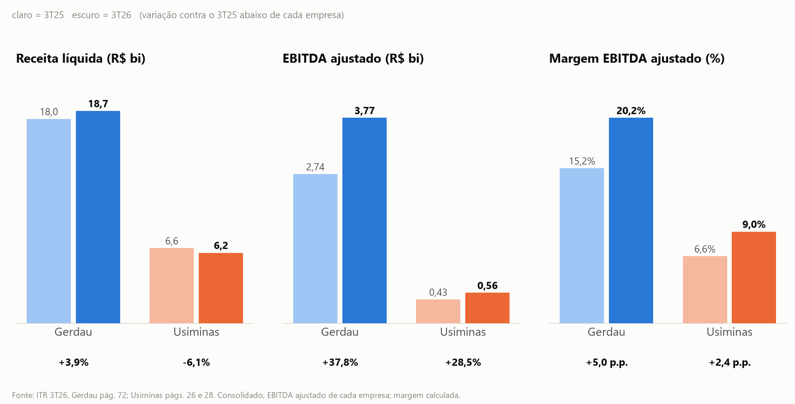
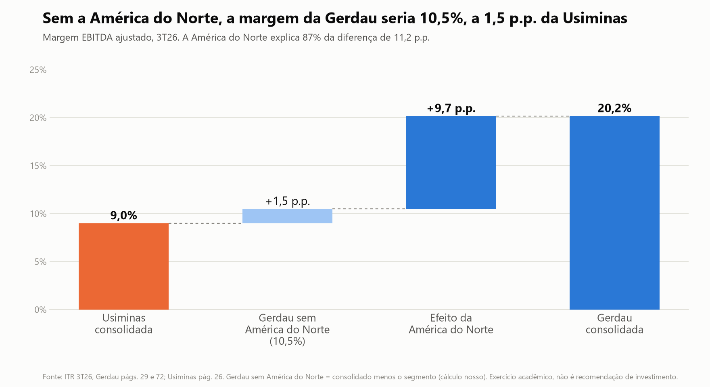
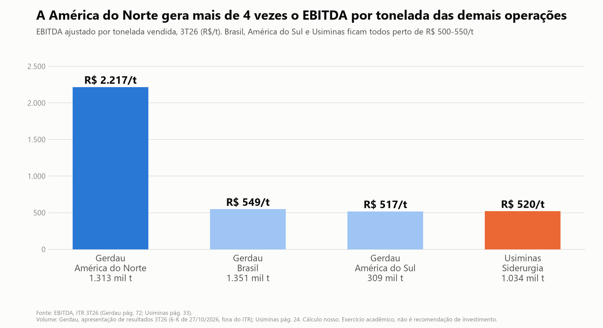

# RJR Capital: Gerdau × Usiminas no 3T26 — Case 3 · Comparativo de resultados

> Claude Lab · Economia & Finanças · PUC-Rio · 06/11/2026
> Projeto acadêmico. Não constitui recomendação de investimento.

**🎬 Vídeo (2 min):** [COLAR O LINK DO VÍDEO AQUI]
**🔗 Artefato público (apresentação):** https://claude.ai/artifact/VPjUz5QMzXdByXByLRVkga

## Equipe

| Nome | Curso / período | Papel no projeto | LinkedIn / GitHub |
|---|---|---|---|
| [nome] | [curso / período] | [papel] | [link] |
| [nome] | [curso / período] | [papel] | [link] |
| [nome] | [curso / período] | [papel] | [link] |
| [nome] | [curso / período] | [papel] | [link] |

## O problema

O diretor de research pediu uma comparação lado a lado de Gerdau e Usiminas no 3º trimestre de 2026, em 6 a 8 slides, para levar ao comitê de investimentos, com a mensagem no título e a página do ITR em cada número. O risco é comparar os consolidados e concluir que "uma empresa é melhor" sem ver que os negócios são muito diferentes: a Gerdau tem 63% da receita fora do Brasil, e a Usiminas é quase toda brasileira. Nosso foco foi responder **quem foi melhor no trimestre e por quê**, com números conferidos contra o ITR.

## A solução

Uma apresentação de 8 slides no formato do roteiro do repositório (capa, resumo executivo, tabela comparativa, gráficos, destaques por empresa, métricas do setor, riscos e fontes), feita a partir de números extraídos e verificados. O arquivo é [apresentacao.html](apresentacao.html), e está publicado no link do artefato acima. Setas ou clique nas laterais navegam, e a tecla **N** mostra o que falar em cada slide.

**A mensagem:** a Gerdau teve o melhor trimestre operacional (margem EBITDA ajustado de 20,2% contra 9,0%) e **87% dessa diferença vem da América do Norte**. Sem os EUA, a margem da Gerdau seria de ~10,5%, a 1,5 p.p. da Usiminas. A Usiminas tem o balanço mais forte (caixa líquido de R$ 471 mi) e depende do mercado brasileiro, que está sob pressão no 4T26.



**Regra do deck:** todo número dos slides é do ITR (com a página) ou calculado a partir dele. Dados de fora do ITR entram nos slides só como afirmação qualitativa, marcada (†, ‡). Os números de fora do ITR ficam aqui, na análise complementar abaixo.

### Análise complementar (fora do ITR, não está nos slides)

O ITR da Gerdau não traz volume, então o EBITDA por tonelada usa o EBITDA do ITR (pág. 72) e o **volume da apresentação de resultados da Gerdau (†)**, que não passa pelo verificador e deve ser conferido no slide original:

| Operação | EBITDA por tonelada, 3T26 |
|---|---|
| Gerdau América do Norte | R$ 2.217/t |
| Gerdau Brasil | R$ 549/t |
| Gerdau América do Sul | R$ 517/t |
| Usiminas Siderurgia (ITR págs. 24 e 33) | R$ 520/t |

Leitura: fora dos EUA, Gerdau e Usiminas rendem o mesmo por tonelada; a América do Norte rende cerca de 4 vezes mais. Segundo um relatório de analista (‡), o preço realizado nos EUA subiu 19% em dólar contra o 3T25, mas a receita por tonelada em reais subiu bem menos, porque o real ficou mais forte.



## Como funciona

O fluxo tem etapas encadeadas, com uma checagem automática no meio:

1. **Extrair:** o texto de cada página dos ITRs vai para `saida/EMPRESA/pagina_NN.txt` (`extrair_paginas.py`).
2. **Extrair as métricas com o Claude:** cada número vai para `metricas_gerdau.json` e `metricas_usiminas.json`, com página, trecho de origem e valor como aparece no PDF.
3. **Verificar:** `verificar_numeros.py` confere trecho, valor, unidade e variação de cada métrica contra o PDF. Se falha, volta para a etapa 2.
4. **Conferências extras:** soma dos segmentos mais eliminações igual ao consolidado, e margens recalculadas contra as divulgadas.
5. **Calcular e comparar:** `comparar.py`, `decomposicao_margem.py` (quanto da diferença de margem vem da América do Norte), `ebitda_por_tonelada.py` e `grafico_trimestre.py`.
6. **Gerar a apresentação:** `gerar_slides.py` lê **só** os JSONs verificados (nenhum número do slide é digitado à mão) e escreve `apresentacao.html` e `notas_apresentador.md`.

Convenção de páginas nos slides: `[G72]` = ITR da Gerdau, pág. 72; `[U26]` = ITR da Usiminas, pág. 26 (sempre a página do PDF). `[calc]` = cálculo nosso. Nos slides, **†** (apresentação de resultados da Gerdau) e **‡** (analistas e dados setoriais) marcam só afirmações qualitativas de fora do ITR, sem números. Números de fora do ITR aparecem apenas na análise complementar acima e não passam pelo verificador.

Arquivos de apoio:
- `kpis_e_contexto_setor.md`: KPIs das duas empresas à luz do modelo de negócio e do momento do setor.
- `drivers_setoriais.md`: drivers do setor por segmento de receita (juros e construção no Brasil, data centers nos EUA, automotivo, minério).
- `estimativa_margem_segmentos.md`: ponte de margem e cenários para o aço longo e plano no Brasil.
- `tabela_comparativa.md` e `.csv`, `mensagens_slides.md` e `notas_apresentador.md`.
- `dados_release_gerdau.json` e `dados_btg.json`: dados fora do ITR, com a origem de cada um.
- `log_erros_claude.md`: onde o Claude errou e como pegamos. `prompts.md`: os prompts principais.
- `roteiro_video.md`: roteiro do vídeo de 2 minutos. `entrega_formulario.md`: o que preencher no formulário de entrega.
- `rodar_tudo.py`: o comando único do PDF ao deck. `skills/apresentacao-resultados-trimestrais/SKILL.md`: a Skill com o padrão da apresentação.

## Dados usados

- **ITRs do 3T26** (`data/case3_resultados/itrs/gerdau_ITR_3T26.pdf` e `usiminas_ITR_3T26.pdf`), consolidados, **até 30/09/2026**. Todos os números dos slides saem daqui: 55 métricas verificadas.
- **Fontes externas complementares** (nos slides, só como contexto qualitativo, marcado † e ‡; seus números só aparecem na análise complementar; não passam pelo verificador):
  - [Apresentação de resultados 3T26 da Gerdau (6-K de 27/10/2026)](https://www.sec.gov/Archives/edgar/data/0001073404/000110465926118998/tm2628297d3_ex99-1.htm): volumes por região, mix de produto e perspectiva. Receita e EBITDA por segmento dela batem com o ITR.
  - BTG Pactual, relatórios de [26/10/2026 (Gerdau)](https://content.btgpactual.com/research/files/file/pt-BR/2026-10-27T093346.358_Gerdau__GGBR4____Os_EUA_salvam_o_dia__de_novo.pdf) e [30/10/2026 (Usiminas)](https://content.btgpactual.com/research/files/file/pt-BR/2026-10-30T093235.605_Usiminas__USIM5____Resultados_do_3T26.pdf): preço em dólar nos EUA, volumes por mercado e preço e custo por tonelada da Usiminas.
  - Genial Investimentos, [resultado](https://analisa.genialinvestimentos.com.br/acoes/USIM5/Usiminas-USIM5--Resultado-do-3T26-EBITDA-Abaixo-do-Esperado-Preco-do-Aco-Pesa/) e [teleconferência](https://analisa.genialinvestimentos.com.br/acoes/USIM5/Usiminas-USIM5--3T26-Call-Caminho-Mais-Longo-para-a-Margem-do-Aco/) da Usiminas (30/10/2026): causas do custo e do preço.
  - Setor: [Aço Brasil](https://www.acobrasil.org.br/site/wp-content/uploads/2026/08/AcoBrasil_EM_Julho_2026.pdf), [CBIC](https://cbic.org.br/pib-construcao-recua-04-no-segundo-trimestre-mas-cresce-11-no-semestre/), [Anfavea via Poder360](https://www.poder360.com.br/poder-economia/producao-de-veiculos-tem-melhor-setembro-desde-2014/), [AGC](https://www.agc.org/sites/default/files/users/user21902/Construction%20Spending%20July%202026.pdf), [Steel Market Update](https://www.steelmarketupdate.com/2026/01/23/cru-fewer-imports-tighten-us-steel-supply-supporting-domestic-prices/) e [IstoÉ Dinheiro](https://istoedinheiro.com.br/minerio-ferro-minima-dois-anos-demanda-china).
  - Recomendações e preços-alvo dos relatórios de analistas foram **ignorados** de propósito.

**Como tratamos os cuidados do case:**

| Cuidado | O que fizemos |
|---|---|
| Holding ≠ consolidado | Só números consolidados. A receita da holding da Gerdau (R$ 1,1 bi, ITR pág. 3) está no JSON marcada "NÃO usar" |
| Contábil ≠ ajustado | EBITDA ajustado de cada empresa, com os ajustes descritos no slide 8 (Gerdau: pág. 72; Usiminas: pág. 28) |
| Efeitos pontuais | Impairment de R$ 2.226 mi no 3T25 da Usiminas (pág. 28): a variação do lucro não é comparável, então a história usa o EBITDA ajustado |
| T/T ≠ A/A | A/A é a base comum, porque o ITR da Gerdau não traz o 2T26. T/T aparece só na Usiminas e sempre rotulado |
| Unidades | R$ mil nos ITRs, convertidos para R$ milhões. O verificador confere valor e unidade |
| Negócios diferentes | Análise por segmento, ponte de margem sem a América do Norte e EBITDA por tonelada |
| Não é recomendação | Aviso na capa e no slide 8 |

## Como verificamos os resultados

1. **O verificador aprovou os 55 números, e provamos que ele pega erro.** Plantamos três erros (dígitos trocados, unidade errada e variação errada) e o verificador pegou os três.
2. **Soma dos segmentos.** Como o verificador só confere se o trecho e o número existem na página, e não se estão na coluna certa, somamos os segmentos da Gerdau mais as eliminações: receita 6.948.113 + 10.512.390 + 1.439.580 − 209.565 = 18.690.518, e EBITDA 741.422 + 2.911.292 + 159.873 − 42.411 = 3.770.176. Os dois batem com o consolidado (pág. 72) e com a DRE (pág. 29), nos dois anos.
3. **Margens recalculadas.** EBITDA ajustado dividido por receita da Usiminas dá 9,0% e 6,6%, iguais às divulgadas (pág. 28).
4. **Dívida líquida da Gerdau.** O ITR não traz o número. Calculamos R$ 7.685,8 mi (empréstimos e debêntures menos caixa e aplicações, págs. 26 e 27), que bate com os R$ 7,69 bi de um relatório de analista e com a alavancagem de 0,58x que a empresa reporta (nós calculamos 0,57x).
5. **Onde o Claude errou e como pegamos** (detalhes em `log_erros_claude.md`): um título de gráfico dizia que a Siderurgia da Usiminas "segura a margem" enquanto a margem caiu de 12,8% para 9,6%; o câmbio foi apontado como causa do ganho dos EUA, e o relatório da BTG mostrou que ele atrapalhou (preço em dólar +19%, em reais +13%); uma fonte de aço plano foi usada como evidência para aço longo; páginas do ITR da Usiminas foram citadas com a numeração impressa no rodapé, e não a do PDF. Todos foram corrigidos.

## Como reproduzir

Dependências: Python 3.10+, `pypdf` e `matplotlib`. Os PDFs dos ITRs estão no repositório do case (`data/case3_resultados/itrs/`).

**Um comando só** (extrai, verifica, calcula e gera o deck; **o deck só sai se todos os números passarem no verificador**):

```bash
pip install -r requirements.txt
python rodar_tudo.py data/case3_resultados/itrs
```

Testamos o caso de erro: com um número alterado de propósito, o fluxo para antes de gerar o deck e mostra o item com ERRO. A **Skill** com o padrão da apresentação está em [skills/apresentacao-resultados-trimestrais/SKILL.md](skills/apresentacao-resultados-trimestrais/SKILL.md).

Ou, passo a passo:

```bash
pip install -r requirements.txt

# 1. texto de cada página dos ITRs (a numeração é a do PDF)
python extrair_paginas.py data/case3_resultados/itrs saida

# 2. verificar cada número contra o PDF
python verificar_numeros.py saida/gerdau metricas_gerdau.json
python verificar_numeros.py saida/usiminas metricas_usiminas.json

# 3. calcular e gerar os gráficos (comparar.py cria a pasta graficos/)
python comparar.py
python decomposicao_margem.py
python ebitda_por_tonelada.py
python grafico_trimestre.py

# 4. gerar a apresentação e as notas do apresentador
python gerar_slides.py
```

Para o próximo trimestre: troque os PDFs, refaça o `metricas_*.json` (prompt 3 em [prompts.md](prompts.md)), rode o verificador e repita os passos 3 e 4. A extração das métricas pelo Claude é a única etapa que ainda é manual.

Os prompts principais que usamos com o Claude estão em [prompts.md](prompts.md).

## Limitações e próximos passos

- **Dados fora do ITR.** Nos slides, só aparecem como afirmação qualitativa (†, ‡). Os números de fora do ITR (volumes da Gerdau, que dão o EBITDA por tonelada, mix de produto e dados de analistas) ficam só na análise complementar do README, não passam pelo verificador e precisam ser conferidos nas fontes originais. Os volumes foram lidos de texto extraído.
- **Sem aço longo contra aço plano da Gerdau.** O ITR só abre por região. O mix de ~70% longo e ~30% plano no Brasil é aproximado, e a margem por tipo de aço não existe; usamos cenários de sensibilidade, não dado.
- **Margem ex-América do Norte é aproximação:** é o consolidado menos o segmento, com as eliminações entre segmentos alocadas ao resto.
- **Base de comparação:** só A/A é comum às duas, porque o ITR da Gerdau não traz o 2T26. Por unidade de negócio, a Usiminas só tem comparação com o 2T26.
- **Dívida líquida e alavancagem da Gerdau são calculadas**, e a alavancagem usa EBITDA de 9 meses anualizado, não os últimos 12 meses.
- **Causas do custo da Usiminas:** o ITR não abre qual insumo subiu. A explicação (coque, placas, dólar) vem de analistas.
- **Com mais um dia:** automatizar também a extração das métricas pelo Claude (hoje o comando único roda do PDF ao deck, mas o `metricas_*.json` ainda é refeito com o Claude a cada trimestre) e refazer sozinho o que o verificador reprovar; buscar o fluxo de caixa livre e o capex nas demonstrações e incluir outros pares do setor.

## Aviso

Projeto acadêmico desenvolvido em workshop. Não constitui recomendação de investimento.

**Feito com:** Claude (claude.ai e Claude Code), Python (pypdf, matplotlib) e HTML/CSS/JavaScript.
